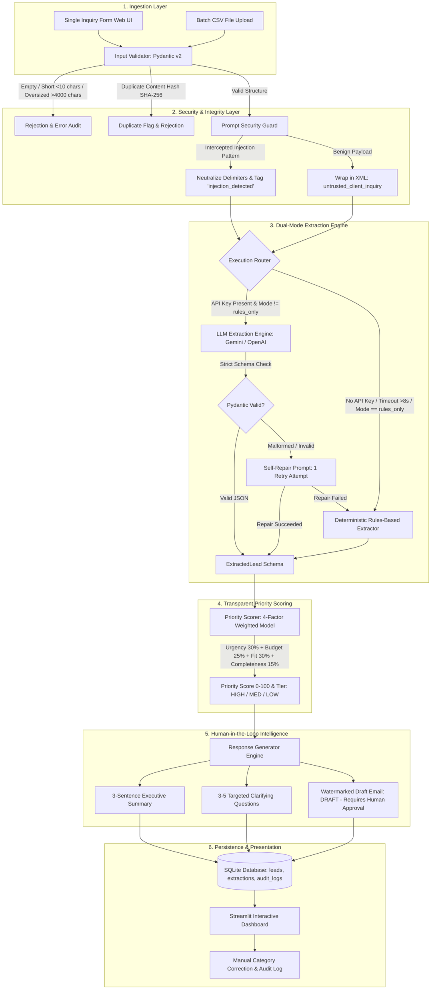
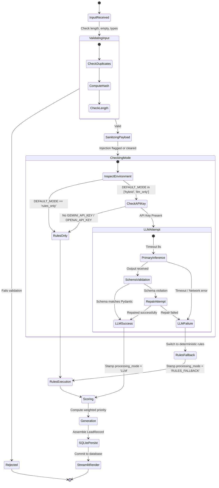
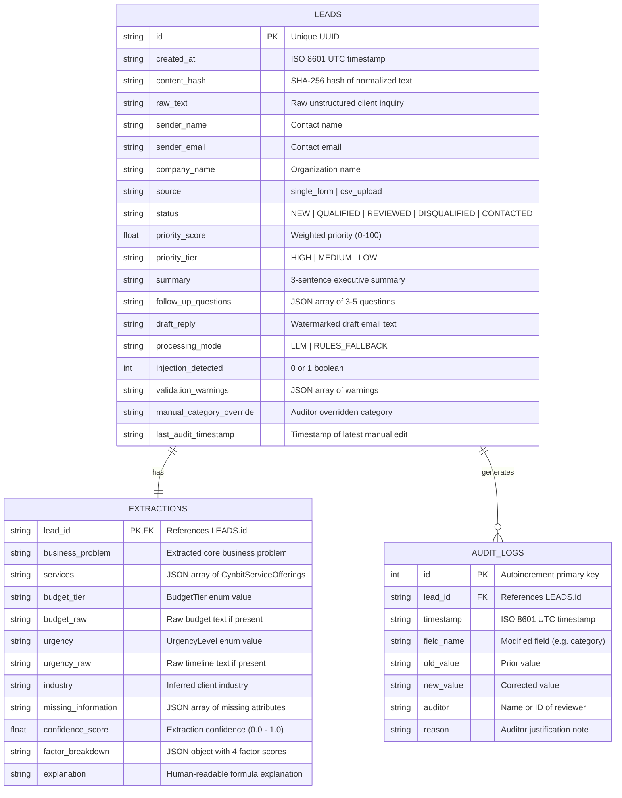

# Cynbit Scout: System Architecture Specification

## 1. System Overview & Philosophy
**Cynbit Scout** is an AI Discovery & Lead Intelligence Copilot built for Cynbit Technologies to automate the intake, qualification, commercial scoring, and human-in-the-loop response drafting of inbound client inquiries.

The core engineering philosophy is **Deterministic Resilience with AI Enhancement**:
- The system must function with **100% operational availability**, even when external LLM APIs are offline, rate-limited, or absent.
- Rule-based outputs are **never disguised as LLM output** (`processing_mode` is tracked immutably).
- Client inputs are treated as **untrusted data**, isolated inside strict boundary delimiters to neutralize prompt injection.
- AI drafts **never auto-send**; all communications require human review and approval.

---

## 2. End-to-End Pipeline Architecture

---

## 3. Dual-Mode Fallback State Machine

The state machine below details how Cynbit Scout transitions between execution states, ensuring zero runtime crashes:

---

## 4. Database Entity-Relationship Model (SQLite)

Cynbit Scout persists leads with relational integrity, tracking the raw payload, parsed attributes, scoring breakdown, and human audit logs.

---

## 5. Security & Isolation Architecture

1. **Untrusted Data Boundary**: User text is treated as an active threat vector. Before entering any LLM prompt, text is sanitized (delimiter sequences stripped) and placed inside `<untrusted_client_inquiry>...</untrusted_client_inquiry>`.
2. **Adversarial Pattern Detector**: Intercepts roleplay jailbreaks (DAN mode), instruction overrides ("ignore previous instructions"), and prompt extraction attempts.
3. **PII Protection**: Regex scrubbers mask email addresses (`u***@domain.com`) and telephone numbers before writing to terminal logs.
4. **Secret Isolation**: Zero API keys are hardcoded in the codebase. Keys are loaded via `.env` and omitted from git tracking.
